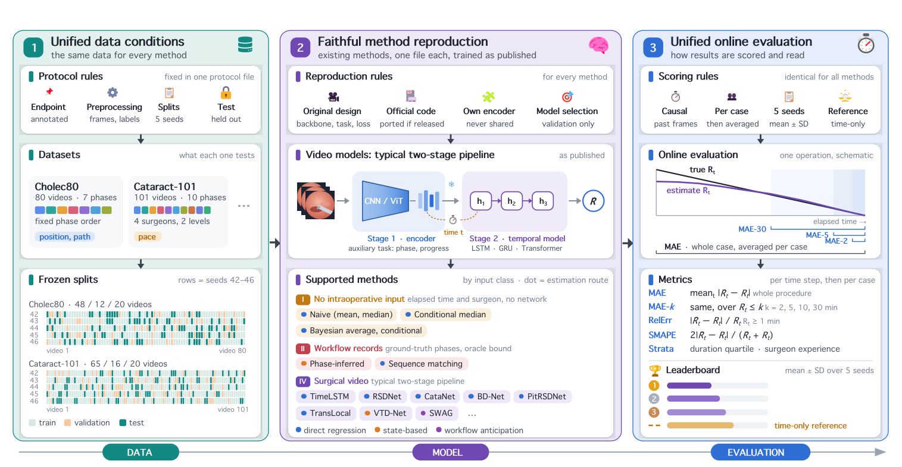
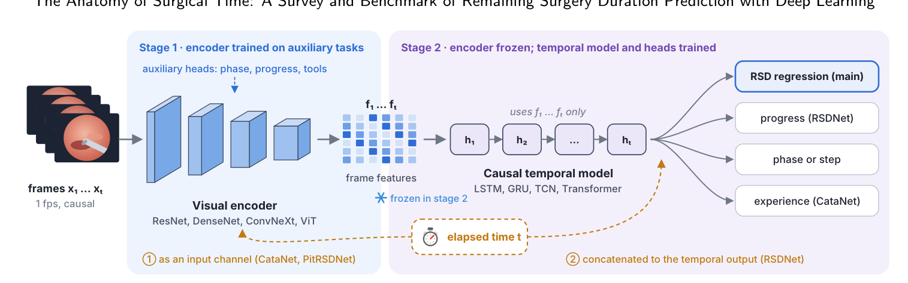

# Remaining Surgery Duration Benchmark (RSDBench)

RSDBench is an open-source library for **remaining surgery duration (RSD)** research. It provides a neat, config-driven codebase to evaluate classical and deep methods, or to develop your own model, under **shared protocols**, **faithful reproductions**, and **unified online evaluation**.

The design follows three pillars (data · model · evaluation). New datasets and methods can be added without changing the overall workflow.

<p align="center">
  
</p>
<p align="center">
  <em>Overall framework of RSDBench: unified data conditions, faithful method reproduction, and unified online evaluation.</em>
</p>

:triangular_flag_on_post: **News** (2026.11) Public release of RSDBench benchmark for RSD methods.

## Leaderboard

Numbers below are **test-set mean ± std** under the unified protocols of the survey (minutes for MAE; fractions for RelErr / SMAPE). **Bold** = best in column; <u>underline</u> = second best (only fully finished method rows are ranked). `—` = not yet reported / not applicable for that protocol. The board will grow as more datasets and methods are added.

| Setting | Method | **Cataract-101** |  |  |  |  | **Cholec80** |  |  |  |  |  |  |
| --- | --- | --- | --- | --- | --- | --- | --- | --- | --- | --- | --- | --- | --- |
|  |  | MAE₂↓ | MAE₅↓ | MAE↓ | RelErr↓ | SMAPE↓ | MAE₂↓ | MAE₅↓ | MAE₁₀↓ | MAE₃₀↓ | MAE↓ | RelErr↓ | SMAPE↓ |
| **Baselines** | NaiveMean | 1.80 ± 0.20 | 2.28 ± 0.19 | 2.78 ± 0.09 | 0.83 ± 0.08 | 0.91 ± 0.03 | 6.63 ± 1.91 | 7.15 ± 1.76 | 7.94 ± 1.58 | 10.20 ± 1.30 | 12.62 ± 1.80 | 1.12 ± 0.24 | 0.81 ± 0.10 |
|  | NaiveMedian | 1.06 ± 0.11 | 1.76 ± 0.09 | 2.58 ± 0.05 | 0.63 ± 0.04 | 0.95 ± 0.03 | 4.96 ± 1.37 | 5.58 ± 1.25 | 6.49 ± 1.10 | 9.07 ± 1.18 | 11.75 ± 2.13 | 0.94 ± 0.18 | 0.81 ± 0.10 |
|  | ConditionalMedian | 1.97 ± 0.09 | 1.41 ± 0.02 | 2.28 ± 0.07 | 0.54 ± 0.02 | 0.62 ± 0.01 | 11.50 ± 1.44 | 10.59 ± 1.34 | 9.22 ± 1.32 | 8.27 ± 1.10 | 11.31 ± 1.63 | 1.13 ± 0.19 | 0.64 ± 0.06 |
|  | BayesianAverage | 0.83 ± 0.16 | 1.04 ± 0.19 | 1.17 ± 0.25 | 0.33 ± 0.06 | 0.48 ± 0.08 | 6.63 ± 1.91 | 7.15 ± 1.76 | 7.94 ± 1.58 | 10.20 ± 1.30 | 12.62 ± 1.80 | 1.12 ± 0.24 | 0.81 ± 0.10 |
|  | BayesianConditional | 1.00 ± 0.12 | 0.97 ± 0.10 | 1.14 ± 0.21 | 0.29 ± 0.04 | 0.39 ± 0.05 | 11.50 ± 1.44 | 10.59 ± 1.34 | 9.22 ± 1.32 | 8.27 ± 1.10 | 11.31 ± 1.63 | 1.13 ± 0.19 | 0.64 ± 0.06 |
|  | PhaseInferred | 0.56 ± 0.05 | 1.01 ± 0.05 | 1.84 ± 0.12 | 0.43 ± 0.02 | 0.50 ± 0.04 | **0.80 ± 0.19** | **1.54 ± 0.30** | <u>2.68 ± 0.40</u> | 5.69 ± 0.60 | 8.96 ± 1.75 | <u>0.47 ± 0.06</u> | 0.53 ± 0.05 |
|  | SequenceMatch | 0.88 ± 0.05 | 1.80 ± 0.12 | 3.07 ± 0.21 | 0.68 ± 0.04 | 1.28 ± 0.07 | 1.12 ± 0.16 | 2.46 ± 0.08 | 4.59 ± 0.16 | 10.89 ± 0.89 | 15.72 ± 2.19 | 0.79 ± 0.04 | 1.44 ± 0.09 |
|  | KostopoulosRF | 0.53 ± 0.04 | 0.93 ± 0.07 | 1.96 ± 0.18 | 0.39 ± 0.03 | 0.56 ± 0.05 | 1.22 ± 0.21 | <u>1.77 ± 0.36</u> | **2.50 ± 0.42** | **5.00 ± 0.57** | **8.53 ± 1.63** | **0.45 ± 0.07** | **0.46 ± 0.04** |
|  | PadoyHMM | 0.96 ± 0.02 | 1.59 ± 0.13 | 2.65 ± 0.26 | 0.62 ± 0.04 | 1.08 ± 0.07 | <u>0.85 ± 0.11</u> | 2.08 ± 0.33 | 3.36 ± 0.37 | 6.53 ± 0.44 | 10.49 ± 1.86 | 0.55 ± 0.07 | 0.66 ± 0.08 |
| **Deep methods** | CataNet | **0.35 ± 0.08** | **0.61 ± 0.13** | **1.01 ± 0.18** | **0.23 ± 0.05** | **0.26 ± 0.05** | — | — | — | — | — | — | — |
|  | BDNet | <u>0.36 ± 0.06</u> | <u>0.64 ± 0.09</u> | <u>1.04 ± 0.15</u> | <u>0.24 ± 0.04</u> | <u>0.26 ± 0.03</u> | 2.77 ± 0.81 | 3.03 ± 0.74 | 4.04 ± 0.55 | <u>5.36 ± 0.75</u> | 8.81 ± 1.51 | 0.54 ± 0.07 | 0.49 ± 0.04 |
|  | TransLocal | 0.65 ± 0.20 | 0.85 ± 0.12 | 1.47 ± 0.18 | 0.32 ± 0.05 | 0.40 ± 0.05 | — | — | — | — | — | — | — |
|  | PitRSDNet | 0.38 ± 0.05 | 0.69 ± 0.08 | 1.04 ± 0.13 | 0.25 ± 0.03 | 0.30 ± 0.03 | 1.47 ± 0.41 | 2.27 ± 0.54 | 3.67 ± 0.55 | 5.68 ± 0.55 | <u>8.68 ± 1.46</u> | 0.54 ± 0.07 | <u>0.47 ± 0.04</u> |
|  | SWAG | 0.65 ± 0.11 | 0.93 ± 0.12 | 1.23 ± 0.17 | 0.34 ± 0.05 | 0.38 ± 0.03 | — | — | — | — | — | — | — |
|  | TimeLSTM | 0.40 ± 0.11 | 0.73 ± 0.18 | 1.28 ± 0.18 | 0.30 ± 0.08 | 0.35 ± 0.05 | 3.77 ± 1.00 | 4.00 ± 1.56 | 5.20 ± 1.72 | 7.03 ± 0.73 | 9.91 ± 1.13 | 0.70 ± 0.17 | 0.55 ± 0.03 |
|  | RSDNet | 0.56 ± 0.10 | 0.83 ± 0.16 | 1.39 ± 0.18 | 0.33 ± 0.07 | 0.39 ± 0.03 | 4.56 ± 1.98 | 4.95 ± 2.12 | 5.89 ± 1.99 | 7.36 ± 1.32 | 10.20 ± 1.66 | 0.79 ± 0.22 | 0.60 ± 0.09 |
|  | VTDNet_V | 0.65 ± 0.15 | 0.86 ± 0.13 | 1.45 ± 0.21 | 0.33 ± 0.06 | 0.39 ± 0.02 | 3.34 ± 0.69 | 3.66 ± 1.00 | 4.80 ± 1.24 | 7.40 ± 1.09 | 10.62 ± 1.74 | 0.69 ± 0.14 | 0.58 ± 0.05 |
|  | VTDNet_VT | — | — | — | — | — | 3.10 ± 0.52 | 3.49 ± 0.92 | 4.71 ± 1.52 | 7.25 ± 1.83 | 10.61 ± 1.01 | 0.67 ± 0.20 | 0.59 ± 0.03 |
|  | Rivoir2019 | — | — | — | — | — | — | — | — | — | — | — | — |
|  | Rivoir2020 | — | — | — | — | — | 10.17 ± 2.48 | 9.04 ± 2.42 | 7.45 ± 2.25 | 6.90 ± 0.33 | 10.87 ± 1.31 | 0.94 ± 0.18 | 0.62 ± 0.04 |
|  | SUPRGAN | — | — | — | — | — | — | — | — | — | — | — | — |

A machine-readable copy is also kept in [`results/leaderboard.md`](./results/leaderboard.md) (refresh with `python -u scripts/collect_results.py` after local runs).

**Compared models of this leaderboard.** ☑ = code included in this repo. Links point to the **original papers**.

**Baselines**
- [x] **NaiveMean / NaiveMedian** — time-only constant predictors
- [x] **ConditionalMedian / BayesianAverage / BayesianConditional** — time-only / surgeon-conditioned references used in the survey
- [x] **PhaseInferred** — oracle phase-duration stack (true phases)
- [x] **SequenceMatch** — sequence matching baseline
- [x] **KostopoulosRF** — Kostopoulos et al., *Biomed. Eng. / Biomed. Tech.*, 2025 [[paper]](https://doi.org/10.1515/bmt-2024-0431)
- [x] **PadoyHMM** — Padoy et al., *Med. Image Anal.*, 2012 [[paper]](https://doi.org/10.1016/j.media.2011.10.001)

**Deep methods**
- [x] **TimeLSTM** — Aksamentov et al., MICCAI 2017 [[paper]](https://doi.org/10.1007/978-3-319-66185-8_66)
- [x] **RSDNet** — Twinanda et al., *IEEE TMI*, 2019 [[paper]](https://doi.org/10.1109/TMI.2018.2878055)
- [x] **CataNet** — Marafioti et al., MICCAI 2021 [[paper]](https://doi.org/10.1007/978-3-030-87202-1_42)
- [x] **BDNet** — Wu et al., MICCAI 2022 / *Comput. Med. Imaging Graph.*, 2023 [[MICCAI]](https://doi.org/10.1007/978-3-031-16449-1_40) [[journal]](https://doi.org/10.1016/j.compmedimag.2023.102314)
- [x] **PitRSDNet** — Wijekoon et al., *Healthc. Technol. Lett.*, 2024 [[paper]](https://doi.org/10.1049/htl2.12095) [[arXiv]](https://arxiv.org/abs/2409.16998)
- [x] **TransLocal** — Loukas et al., *Int. J. Med. Robot.*, 2024 [[paper]](https://doi.org/10.1002/rcs.2632)
- [x] **VTDNet** — Bodenstedt et al., *IJCARS*, 2019 [[paper]](https://doi.org/10.1007/s11548-019-01979-1)
- [x] **SWAG** — Boels et al., *IJCARS*, 2025 [[paper]](https://doi.org/10.1007/s11548-025-03452-8)
- [x] **Rivoir2019** — Rivoir et al., OR 2.0 / MLCN 2019 [[paper]](https://doi.org/10.1007/978-3-030-32695-1_4)
- [x] **Rivoir2020** — Rivoir et al., MICCAI 2020 [[paper]](https://doi.org/10.1007/978-3-030-59716-0_72) [[arXiv]](https://arxiv.org/abs/2007.00548)
- [x] **SUPRGAN** — Ban et al., *IEEE RA-L*, 2022 [[paper]](https://doi.org/10.1109/LRA.2022.3185364)

Many video-based methods follow a typical two-stage training pattern (frame encoder → temporal head):

<p align="center">
  
</p>

## Getting Started

### Prepare Data

Set a data root (default: `<repo_parent>/DATASET`) and place each dataset in its own subdirectory. Current releases ship with example protocols; **additional datasets can be registered** under `data_provider/` + `configs/protocol/` + `configs/data/`.

```bash
export RSDBENCH_DATA_ROOT=/path/to/DATASET   # optional
export RSDBENCH_CACHE_ROOT=/path/to/cache    # optional; default <repo>/.cache
```

```text
$RSDBENCH_DATA_ROOT/
├── <dataset_a>/     # videos + annotations (layout defined per dataset)
├── <dataset_b>/
└── ...
```

See [`configs/data/default.yaml`](./configs/data/default.yaml) and the corresponding protocol YAML for each supported dataset.

### Installation

1. Clone this repository.

```bash
git clone https://github.com/kanxueli/RSDBench.git
cd RSDBench
```

2. Create the conda environment (CUDA PyTorch required for deep models).

```bash
bash scripts/setup_env.sh
conda activate rsdbench
```

Or manually:

```bash
conda create -n rsdbench python=3.10 -y
conda activate rsdbench
# install a CUDA build of torch that matches your driver, then:
pip install -r requirements.txt
python -c "import torch; assert torch.cuda.is_available(); print(torch.cuda.get_device_name(0))"
```

> **CUDA notice.** Deep methods refuse CPU by default. Install a GPU build of PyTorch that matches your local CUDA.

### Quick Test

Baselines (example protocol; replace with any registered dataset/protocol):

```bash
conda activate rsdbench
python run.py --model ConditionalMedian \
  --protocol configs/protocol/<dataset>_main.yaml \
  --override split.n_repeats=1 split.seed_start=42
```

### Train and Evaluate

Unified entry:

```bash
python run.py --model <NAME> \
  --protocol configs/protocol/<dataset>_main.yaml \
  [--model_cfg configs/experiment/<dataset>_<NAME>.yaml] \
  --exp_name <dataset>_<NAME> \
  --override split.n_repeats=1 split.seed_start=42
```

Use a dataset overlay YAML when a method needs dataset-specific settings (e.g. number of phases, max length). After local runs, refresh the board with `python -u scripts/collect_results.py`.

### Develop Your Own Model / Dataset

**New model**
1. Add `./models/YourModel.py` (follow an existing file such as `models/PitRSDNet.py`).
2. Register the name in `models/__init__.py` and wire `run.py` / `exp/` if you need a custom loop.
3. Add `configs/model/YourModel.yaml` and, if needed, `configs/experiment/<dataset>_YourModel.yaml`.
4. Train / evaluate through `run.py`.

**New dataset**
1. Implement a dataset class under `data_provider/datasets/` and register it in the factory.
2. Add `configs/protocol/<dataset>_main.yaml` (splits, seeds, eval windows).
3. Extend `configs/data/default.yaml` with roots / file layout.
4. Optionally extend leaderboard columns via `scripts/collect_results.py`.

## Project Structure

```text
RSDBench/
├── README.md
├── pic/                   # framework figures
├── requirements.txt / environment.yml
├── run.py                 # unified entry
├── configs/
│   ├── protocol/          # per-dataset evaluation protocols
│   ├── data/              # portable data & cache roots
│   ├── model/             # default hyperparameters per method
│   ├── experiment/        # dataset-specific overlays
│   └── train/             # shared train defaults
├── data_provider/         # datasets, factory, frozen splits
├── models/                # one method = one file
├── exp/                   # train / val / test loops
├── layers/                # shared building blocks
├── preprocessing/         # frame & feature preparation
├── scripts/               # env setup, metrics / leaderboard helpers
├── utils/                 # config, metrics, splits, IO
└── results/leaderboard.md # living benchmark table
```

## Citation

If you find this repository or the benchmark useful, please cite the survey (this codebase accompanies the paper), and cite the original papers of the methods you compare.

```bibtex
@article{Li2025AnatomySurgicalTime,
  title   = {The Anatomy of Surgical Time: A Survey and Benchmark of Remaining Surgery Duration Prediction with Deep Learning},
  author  = {Li, Kanxue and Jing, Yongcheng and Yu, Baosheng and Zhan, Yibing and Chen, Xi and Liang, Siyuan and Du, Bo and Tao, Dacheng},
  journal = {},
  year    = {2026}
}
```

## Contact

If you have any questions or suggestions, feel free to open an issue or contact the maintainers via GitHub.
